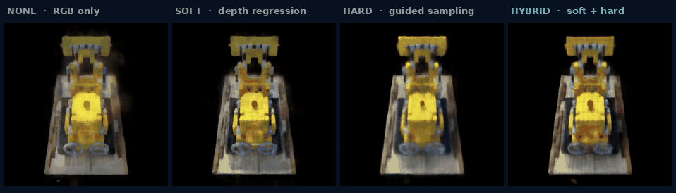

 

**Robotics and AI Engineer**  ·  🌐 **[Full portfolio: umerahmedbaig7.github.io](https://umerahmedbaig7.github.io/)**

## About

I build robots and ML systems that **perceive, plan and act**, and I test them until I can state exactly where they work and where they don't. MSc in Robotics and AI at **ITMO University** (CGPA 4.82/5, Diploma with Honours), with an electronics background and three years in LED photometry and R&D labs before that.

My research covers autonomous navigation (published), depth-supervised 3D reconstruction (under review), and few-shot defect detection for robotic inspection (MSc thesis). On the engineering side I build document-AI and backend systems with tests, CI and honest evaluation.

More projects, photo galleries from the ROSATOM competitions and press are on my **[portfolio website](https://umerahmedbaig7.github.io/)**.

> **Open to:** PhD and research opportunities, research collaborations, and engineering roles in robotics, perception, robot learning and applied AI.

---

## Results at a glance

Numbers come from my papers, thesis tables and stored evaluation files. Navigation results are simulation only. NeRF results are on the synthetic Lego scene (PSNR axis starts at 18 dB). Crack-detection results use a 30-image validation set. ProcuraAI is a prototype evaluated on synthetic data that I generated, so its structured-input score is optimistic and the OCR-document score is the honest one.

---

## Featured work

### 1 &nbsp;·&nbsp; TriLayer-Nav: A* + DWA + MPC navigation &nbsp;`Published`

A three-layer navigation stack for differential-drive robots: **A\*** plans a global path, the **Dynamic Window Approach** avoids obstacles in real time, **MPC** refines the commands under non-holonomic and actuator limits, and a **PID** loop drives the wheels. Validated in MuJoCo physics simulation. First author, *Gyroscopy and Navigation*, 2026.

<table>
<tr>
<td width="33%"></td>
<td width="33%"></td>
<td width="33%"></td>
</tr>
<tr>
<td align="center">MuJoCo arena</td>
<td align="center">Layered architecture</td>
<td align="center">One analysed run: path, heading, DWA vs MPC commands</td>
</tr>
</table>

- **Result:** 96.6% success (116 / 120 runs) vs 71.6% for DWA alone and 76.6% for A\*+DWA, over 12 scenarios x 10 runs per architecture; final position error ≤ 0.2 m.
- **Setup:** 12 kg differential-drive robot, 10 x 10 m arena with narrow corridors, 50 Hz control, MuJoCo 3.3.2.
- **Limits:** simulation only; hardware tests are future work.

 

---

### 2 &nbsp;·&nbsp; Depth-supervised NeRF &nbsp;`Under review`

Which way of using depth improves NeRF training most when architecture, data and budget are identical? I compared four strategies on one 8x256 MLP: **RGB-only**, **soft** depth regression, **hard** depth-guided sampling with free-space and surface penalties, and a **hybrid** of both. First and corresponding author; submitted to the *Journal of The Visual Computer*.

 Novel-view renders of the Lego scene from the four training strategies (repository experiments).

 Validation frame 0: renderings and error maps x4 with per-frame PSNR / SSIM.

| Lego, 100 held-out views | PSNR ↑ | SSIM ↑ | MSE ↓ (x10⁻³) | MAE ↓ (x10⁻²) |
|---|:--:|:--:|:--:|:--:|
| RGB only | 20.21 dB | 0.658 | 10.15 | 4.77 |
| Soft | 20.71 dB | 0.522 | 8.83 | 4.82 |
| Hard | 21.17 dB | 0.685 | 7.88 | 3.93 |
| **Hybrid** | **22.36 dB** | **0.778** | **5.98** | **3.18** |

- Hybrid is the **only** strategy that improves both PSNR and SSIM on both scenes (Chair: 19.48 → 21.62 dB, SSIM 0.701 → 0.838).
- It reaches within 0.5 dB of the baseline's best quality after **2,000 iterations** vs 16,000 (Lego) and 19,000 (Chair).
- I also report where depth hurts: soft supervision lowers SSIM on Lego, hard guidance lowers SSIM on Chair.
- **Limits (stated in the paper):** one run per strategy, photometric metrics only, no geometric error evaluation yet.

---

### 3 &nbsp;·&nbsp; MSc thesis: few-shot structural defect detection &nbsp;`Completed`

Detecting a **new defect class from a handful of labelled images**, motivated by robotic inspection of concrete and pavement. Evaluated offline on images; no robot deployment.

- **Base detector:** YOLOv8n on four defect classes (1,120 training images) → **0.79 mAP@50** on 140 validation images.
- **Few-shot crack class:** mAP@50 rises from **0.22 (5 images) to 0.53 (30 images)**; precision from 0.05 to 0.78, while recall on thin cracks stays the bottleneck.
- **Distillation** (T = 4, α = 0.7) lifts 30-shot validation mAP@50 to 0.61, but the gain is not consistent across shot counts.
- **Robustness:** 6 perturbations x 3 severities. At least **66% of baseline mAP** survives blur, fog, brightness and contrast shifts; large rotations are the failure mode.
- **Limits:** the crack validation set has 30 images. Thesis code is not public yet.

---

### 4 &nbsp;·&nbsp; ProcuraAI: AI invoice auditor &nbsp;`Prototype · synthetic data`

Three-way matching (purchase order ↔ delivery ↔ invoice) where **the LLM reads and explains but never decides**: money rules run in a deterministic Decimal engine, and every finding carries evidence and a confidence label.

<table>
<tr>
<td width="33%"></td>
<td width="33%"></td>
<td width="33%"></td>
</tr>
<tr>
<td align="center">Streamlit dashboard</td>
<td align="center">RAG evidence with citations</td>
<td align="center">Human-review queue</td>
</tr>
</table>

- **Stack:** FastAPI + Streamlit, 4-agent **LangGraph** workflow, **FAISS + BM25** hybrid retrieval, Tesseract OCR with PyMuPDF, Pydantic, SQLAlchemy, Docker, GitHub Actions, about 5,700 lines of source and about 50 offline tests.
- **Results (72 synthetic invoices, 25 anomaly scenarios):** all 42 anomalous invoices flagged; on OCR'd documents precision **0.70**, recall **0.98**, F1 **0.82**; RAG Recall@3 = **1.00** over 70 queries.
- **Limits:** synthetic, template-based documents; not validated on real invoices; exposure totals from OCR are unreliable.

---

### 5 &nbsp;·&nbsp; Hybrid ARIMAX–LSTM PM2.5 forecasting for robot-assisted monitoring &nbsp;`Co-author · under review`

ARIMAX captures the linear and seasonal structure; a two-layer LSTM trained on its residuals captures the rest. On 12 Beijing stations the hybrid reaches **MAE 11.20 µg/m³ and R² 0.949**, vs 26.62 / 0.765 for ARIMAX alone and 17.41 / 0.907 for LSTM alone. The forecast drives a four-state monitoring policy (patrol → emergency), evaluated by replaying historical data rather than on a physical robot. Manuscript under review at *Atmospheric Research*.

---

### 6 &nbsp;·&nbsp; Fuel Route Optimizer API &nbsp;`Completed`

A Django REST Framework service that plans a USA road trip and chooses the **cheapest fuel stops** for a 500-mile range at 10 mpg, with a live Leaflet / OpenStreetMap map.

 A real run: New York → Columbia, SC · 710.1 mi · 2 stops · $238.58 total fuel cost · $3.86 saved vs filling at the farthest station.

- **Engine:** dynamic programming over (station, fuel level) keeps every leg ≤ 500 miles including detours; one routing call per trip with caching and throttling.
- **Data:** 8,151 price rows cleaned to 6,626 US stations, placed offline by ZIP centroid (no per-row geocoding).
- **Quality:** 97 automated tests and CI.

---

## More from my MSc coursework and side projects

<b>Perception, estimation and learning (click to expand)</b>

 

<table>
<tr>
<td width="50%"> <b>Stereo vision.</b> StereoSGBM disparity and depth from calibrated pairs. <a href="https://github.com/umerahmedbaig7/Robot-Perception">Robot-Perception</a></td>
<td width="50%"> <b>State estimation.</b> EKF and UKF coded from the equations. <a href="https://github.com/umerahmedbaig7/Robot-Perception">Robot-Perception</a></td>
</tr>
<tr>
<td width="50%"> <b>Segmentation.</b> SegNet on road signs, augmentation lifts test IoU 0.619 → 0.669 (README-reported). <a href="https://github.com/umerahmedbaig7/Machine-Learning-in-Robotics">Machine-Learning-in-Robotics</a></td>
<td width="50%"> <b>Representation learning.</b> Convolutional autoencoder, t-SNE and KMeans clustering. <a href="https://github.com/umerahmedbaig7/Machine-Learning-in-Robotics">Machine-Learning-in-Robotics</a></td>
</tr>
</table>

<b>Planning, control and simulation (click to expand)</b>

 

<table>
<tr>
<td width="50%"> <b>Computed-torque control</b> of a 6-DOF Stanford arm (RK45), with a payload known to the model. <a href="https://github.com/umerahmedbaig7/Robot-Motion-Planning-and-Control">Robot-Motion-Planning-and-Control</a></td>
<td width="50%"> <b>Potential-field planner</b> from scratch: BFS distance transform, conical attraction, Khatib repulsion. <a href="https://github.com/umerahmedbaig7/Potential-Field-Path-Planning">Potential-Field-Path-Planning</a></td>
</tr>
<tr>
<td width="50%"> <b>Numerical integration.</b> Forward Euler turns unstable above about 6 ms; RK4 and backward Euler stay stable. <a href="https://github.com/umerahmedbaig7/Simulation-of-Robotic-Systems">Simulation-of-Robotic-Systems</a></td>
<td width="50%"> <b>Manipulator kinematics.</b> DH forward kinematics, closed-form IK, symbolic Jacobian. <a href="https://github.com/umerahmedbaig7/Robot-Modeling-and-Identification">Robot-Modeling-and-Identification</a></td>
</tr>
</table>

**Deep RL and physics-informed learning** ([Robotics-and-Reinforcement-Learning](https://github.com/umerahmedbaig7/Robotics-and-Reinforcement-Learning)): DQN, REINFORCE and PPO with GAE implemented from scratch; PPO stabilises Acrobot-v1 within 170 episodes; reverse-curriculum learning lifts sparse-reward MountainCar from 0% to 80–90% success; PINNs extrapolate an ODE from 50 noisy samples.

<b>Optimisation and tabular ML (click to expand)</b>

 

<table>
<tr>
<td width="50%"> <b>Metaheuristics.</b> Brute force, gradient descent, simulated annealing, genetic algorithm and Hooke–Jeeves on the Beale function. <a href="https://github.com/umerahmedbaig7/Metaheuristic-Optimization-Beale-Function">Beale repository</a></td>
<td width="50%"> <b>Freight-rate forecasting.</b> LightGBM with rolling-origin validation: MAE about $45 vs $82 for the baseline on clean labels. <a href="https://github.com/umerahmedbaig7/freight-rate-prediction-using-LightGBM-regression">Freight repository</a></td>
</tr>
</table>

---

## Skills, backed by code

Every dot below is a public repository with working code for that skill. No self-ratings.

**Languages and libraries:** Python · NumPy · SciPy · Matplotlib · pandas · SymPy · PyTorch · torchvision · scikit-learn · scikit-image · LightGBM · OpenCV

**Robotics:** MuJoCo · Gymnasium · Stable-Baselines3 · Robotics Toolbox for Python

**LLM and backend:** LangGraph · FAISS · BM25 · Pydantic · FastAPI · Django REST Framework · Streamlit · SQLAlchemy · Tesseract / PyMuPDF · Docker · GitHub Actions · pytest

**Earlier work (BEng thesis, 2020):** TensorFlow / Keras, Mask R-CNN, SSD, Arduino

---

## Publications

1. **U. A. B. Mughal**, A. Ali, Urwa, M. V. Abramchuk. *TriLayer-Nav: A Tri-Layer Navigation Framework Integrating A\*, Dynamic Window Approach, and Model Predictive Control for Differential-Drive Robots.* **Gyroscopy and Navigation**, 17(1), 24–33, 2026. [DOI 10.1134/S2075108726700094](https://doi.org/10.1134/S2075108726700094)
2. **U. A. B. Mughal**, A. Ali, Urwa, M. V. Abramchuk. *Depth-supervised NeRF for 3D scene reconstruction.* Submitted to the **Journal of The Visual Computer**, 2026 (under review).
3. Hybrid ARIMAX–LSTM framework for robot-assisted PM2.5 forecasting. Co-author. **Atmospheric Research**, 2026 (under review).
4. S. Memon, M. Ahmed, S. Narejo, **U. A. Baig**, B. S. Chowdhry, M. R. Anjum. *Self-Driving Car Using LiDAR Sensing and Image Processing.* **Int. J. Grid and Distributed Computing**, 13(2), 77–88, 2020. [DOI 10.33832/ijgdc.2020.13.2.06](https://doi.org/10.33832/ijgdc.2020.13.2.06) · [ResearchGate](https://www.researchgate.net/publication/350997511_SELF-DRIVING_CAR_USING_LIDAR_SENSING_AND_IMAGE_PROCESSING)

**MSc thesis:** *Development of a Few-Shot Learning Framework for Robust Structural Anomaly Detection with Robotic Inspection*, ITMO University, 2026.

---

## Education and recognition

**MSc Robotics and Artificial Intelligence**, ITMO University, Saint Petersburg · 2024–2026 · CGPA 4.82 / 5.0 · Diploma with Honours
**BEng Electronic Engineering**, Mehran University of Engineering and Technology · 2016–2019

- Open Doors International Olympiad 2024: prize-winner, Engineering & Technology (Master's track)
- ObninskTech Summer University 2025 (ROSATOM, MEPhI): 1st place, Engineering Hackathon · 1st place, Atomic Triathlon
- ObninskTech Winter School: 3rd place, Engineering Hackathon
- World Atomic Week 2025, Global HackAtom: participant representing ITMO University ([national stage results](https://hackatom.energy/en/novosti/national-stage-russia/))
- Press: [ITMO News interview, "A Master's student's perspective on robotics and AI"](https://news.itmo.ru/en/education/students/news/14899/)

---

## Get in touch

| | |
|---|---|
| 🌐 **Portfolio** | [umerahmedbaig7.github.io](https://umerahmedbaig7.github.io/) |
| 💼 **LinkedIn** | [linkedin.com/in/umer-ahmed-baig7](https://www.linkedin.com/in/umer-ahmed-baig7) |
| 💻 **GitHub** | [github.com/umerahmedbaig7](https://github.com/umerahmedbaig7) |
| 🎓 **ORCID** | [0000-0002-2683-8886](https://orcid.org/0000-0002-2683-8886) |
| ✉️ **Email** | [umerahmedbaig98@gmail.com](mailto:umerahmedbaig98@gmail.com) |
| 📍 **Location** | Hyderabad, Pakistan |

Robots that perceive, plan and act, with the evidence to back it up.

