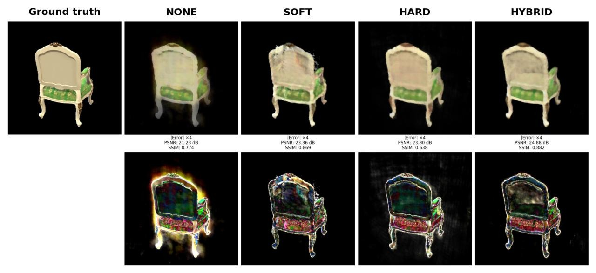
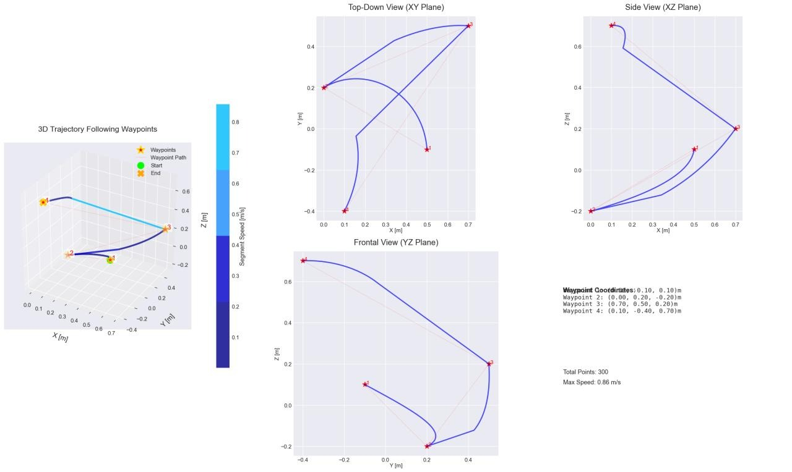
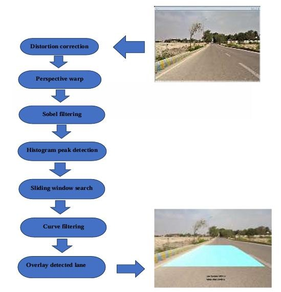
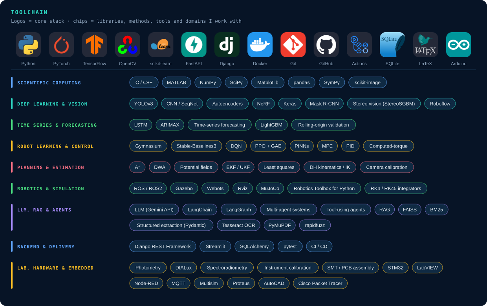
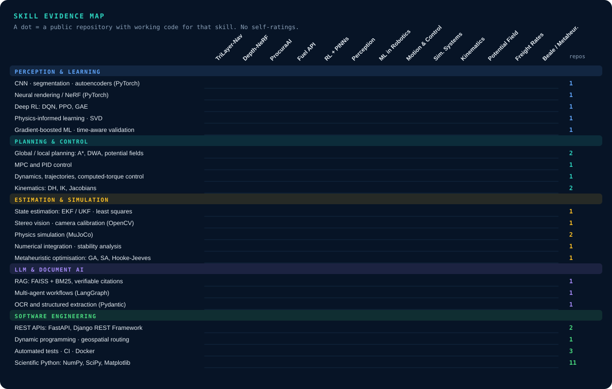

 

**Robotics and AI Engineer** · Hyderabad, Pakistan · 🌐 **[Full portfolio: umerahmedbaig7.github.io](https://umerahmedbaig7.github.io/)**

Robotics and AI engineer (MSc Robotics and AI, ITMO University, CGPA 4.82/5.0). I build and rigorously evaluate systems for robot navigation, reinforcement learning, robot perception, robot manipulation, 3D reconstruction and applied machine learning. Author of a peer-reviewed navigation paper (*Gyroscopy and Navigation*, 2026) and a NeRF depth-supervision manuscript; I also build tested Python systems (Django/FastAPI services, RAG with LangGraph, LightGBM pipelines). Previously spent 3+ years in LED-lighting photometry, R&D and quality-testing laboratories, leading the lab as Lab Manager for the last two.

## About

I build robots and ML systems that **perceive, plan and act**, and I test them until I can state exactly where they work and where they don't.

My research covers autonomous navigation (published), depth-supervised 3D reconstruction (under review), and few-shot defect detection for robotic inspection (MSc thesis). On the engineering side I build document-AI and backend systems with tests, CI and honest evaluation.

More projects, photo galleries from the ROSATOM competitions and press are on my **[portfolio website](https://umerahmedbaig7.github.io/)**.

> **Open to:** PhD and research opportunities, research collaborations, and engineering roles in robotics, perception, robot learning and applied AI.

---

## Results at a glance

Numbers come from my papers, thesis tables and stored evaluation files. Navigation results are simulation only. NeRF results are on the synthetic Lego scene (PSNR axis starts at 18 dB). Crack-detection results use a 30-image validation set. ProcuraAI is a prototype evaluated on synthetic data that I generated, so its structured-input score is optimistic and the OCR-document score is the honest one.

---

## Featured work

### 1 &nbsp;·&nbsp; TriLayer-Nav: A* + DWA + MPC navigation &nbsp;`Published`

A three-layer navigation stack for differential-drive robots: **A\*** plans a global path, the **Dynamic Window Approach** avoids obstacles in real time, **MPC** (4-step horizon, SLSQP) refines the commands under non-holonomic and actuator limits, and a **PID** loop drives the wheels. A\* paths are simplified with Ramer–Douglas–Peucker. Validated in MuJoCo physics simulation. First author, *Gyroscopy and Navigation*, 2026.

<table>
<tr>
<td width="33%"></td>
<td width="33%"></td>
<td width="33%"></td>
</tr>
<tr>
<td align="center">MuJoCo arena</td>
<td align="center">Layered architecture</td>
<td align="center">One analysed run: path, heading, DWA vs MPC commands</td>
</tr>
</table>

- **Result:** 96.6% success (116 / 120 runs) vs 71.6% for DWA alone and 76.6% for A\*+DWA, over 12 scenarios x 10 runs per architecture; final position error ≤ 0.2 m.
- **Setup:** 12 kg differential-drive robot, 10 x 10 m arena with narrow corridors, 50 Hz control, MuJoCo 3.3.2.
- **Limits:** simulation only; hardware tests are future work.

 

---

### 2 &nbsp;·&nbsp; Depth-supervised NeRF &nbsp;`Under review`

Which way of using depth improves NeRF training most when architecture, data and budget are identical? I compared four strategies on one 8x256 MLP: **RGB-only**, **soft** depth regression, **hard** depth-guided sampling with free-space and surface penalties, and a **hybrid** of both. First and corresponding author; submitted to *The Visual Computer* (under review).

 Novel-view renders of the Lego scene from the four training strategies (repository experiments).

 Lego, validation frame 0: renderings and error maps x4 with per-frame PSNR / SSIM.

 Chair scene: ground truth vs the four strategies, with error maps.

| Lego, 100 held-out views | PSNR ↑ | SSIM ↑ | MSE ↓ (x10⁻³) | MAE ↓ (x10⁻²) |
|---|:--:|:--:|:--:|:--:|
| RGB only | 20.21 dB | 0.658 | 10.15 | 4.77 |
| Soft | 20.71 dB | 0.522 | 8.83 | 4.82 |
| Hard | 21.17 dB | 0.685 | 7.88 | 3.93 |
| **Hybrid** | **22.36 dB** | **0.778** | **5.98** | **3.18** |

- Hybrid is the **only** strategy that improves both PSNR and SSIM on both scenes (Chair: 19.48 → 21.62 dB, SSIM 0.701 → 0.838).
- It reaches within 0.5 dB of the baseline's best quality after **2,000 iterations** vs 16,000 (Lego) and 19,000 (Chair).
- Also reported: per-view, checkpoint-sensitivity and train–validation-gap analyses, and where depth hurts: soft supervision lowers SSIM on Lego, hard guidance lowers SSIM on Chair.
- **Limits (stated in the paper):** one run per strategy, photometric metrics only, no geometric error evaluation yet.

---

### 3 &nbsp;·&nbsp; MSc thesis: few-shot structural defect detection &nbsp;`Completed`

Detecting a **new defect class from a handful of labelled images**, motivated by robotic inspection of concrete and pavement. Evaluated offline on images; no robot deployment.

- **Base detector:** YOLOv8n on four defect classes (1,120 training images) → **0.79 mAP@50** on 140 validation images.
- **Few-shot crack class:** mAP@50 rises from **0.22 (5 images) to 0.53 (30 images)**; precision from 0.05 to 0.78, while recall on thin cracks stays the bottleneck.
- **Distillation** (T = 4, α = 0.7) lifts 30-shot validation mAP@50 to 0.61, but the gain is not consistent across shot counts.
- **Robustness:** 6 perturbations x 3 severities. At least **66% of baseline mAP** survives blur, fog, brightness and contrast shifts; large rotations are the failure mode.
- **Limits:** the crack validation set has 30 images. Thesis code is not public yet.

---

### 4 &nbsp;·&nbsp; ProcuraAI: AI invoice auditor &nbsp;`Prototype · synthetic data`

Three-way matching (purchase order ↔ delivery ↔ invoice) where **the LLM reads and explains but never decides**: money rules run in a deterministic Decimal engine, and every finding carries evidence and a confidence label.

<table>
<tr>
<td width="33%"></td>
<td width="33%"></td>
<td width="33%"></td>
</tr>
<tr>
<td align="center">Streamlit dashboard</td>
<td align="center">RAG evidence with citations</td>
<td align="center">Human-review queue</td>
</tr>
</table>

- **Stack:** FastAPI + Streamlit, 4-agent **LangGraph** workflow, **FAISS + BM25** hybrid retrieval, Tesseract OCR with PyMuPDF, Pydantic, SQLAlchemy, Docker, GitHub Actions, about 5,700 lines of source and about 50 offline tests.
- **Results (72 synthetic invoices, 25 anomaly scenarios):** all 42 anomalous invoices flagged; on OCR'd documents precision **0.70**, recall **0.98**, F1 **0.82**; RAG Recall@3 = **1.00** over 70 queries.
- **Limits:** synthetic, template-based documents; not validated on real invoices; exposure totals from OCR are unreliable.

---

### 5 &nbsp;·&nbsp; Hybrid ARIMAX–LSTM PM2.5 forecasting for robot-assisted monitoring &nbsp;`Co-author · under review`

ARIMAX captures the linear and seasonal structure; a two-layer LSTM trained on its residuals captures the rest. On 12 Beijing stations the hybrid reaches **MAE 11.20 µg/m³ and R² 0.949**, vs 26.62 / 0.765 for ARIMAX alone and 17.41 / 0.907 for LSTM alone. The forecast drives a four-state monitoring policy (< 35 patrol, 35–75 monitor, 75–150 alert, > 150 µg/m³ emergency) with a +10 µg/m³/h trend-escalation trigger, sampling from 1 to 60 per hour and a 1 → 10 sensor cascade, evaluated by replaying historical data rather than on a physical robot. Manuscript under review at *Atmospheric Research*.

---

### 6 &nbsp;·&nbsp; Fuel Route Optimizer API &nbsp;`Completed`

A Django REST Framework service that plans a USA road trip and chooses the **cheapest fuel stops** for a 500-mile range at 10 mpg, with a live Leaflet / OpenStreetMap map.

 A real run: New York → Columbia, SC · 710.1 mi · 2 stops · $238.58 total fuel cost · $3.86 saved vs filling at the farthest station.

- **Engine:** dynamic programming over (station, fuel level) keeps every leg ≤ 500 miles including detours; one routing call per trip with caching and throttling.
- **Data:** 8,151 price rows cleaned to 6,626 US stations, placed offline by ZIP centroid (no per-row geocoding).
- **Quality:** 97 automated tests and CI.

---

## MSc coursework and BEng thesis

Hands-on implementations from my ITMO robotics courses and my undergraduate thesis. Each links to its repository.

### 7 &nbsp;·&nbsp; Stanford Arm: dynamics, trajectory planning and computed-torque control &nbsp;`Coursework`

`Robotics` `Control Systems` `Python` `Trajectory Planning` `Simulation` &nbsp;·&nbsp; [Robot-Motion-Planning-and-Control](https://github.com/umerahmedbaig7/Robot-Motion-Planning-and-Control) &nbsp;·&nbsp; Feb 2025 – Jun 2025

- Newton–Euler inverse dynamics via Robotics Toolbox for Python, extracting M(q), C(q, q̇) and G(q).
- 27,000-point workspace map; Gauss-Newton and Levenberg–Marquardt IK; `jtraj` vs LSPB vs quintic trajectories; 4-waypoint, 9 s trajectory with a torque feasibility check.
- Computed-torque PD control simulated with RK45. With a 200 kg payload known to the model, RMS tracking error changed by under 3% on all joints.

<table>
<tr>
<td width="50%"></td>
<td width="50%"></td>
</tr>
</table>
Left: 4-waypoint, 9 s end-effector trajectory (3D and projections). Right: joint tracking with a payload known to the model.

---

### 8 &nbsp;·&nbsp; Simulation of robotic systems: numerical integration and MuJoCo &nbsp;`Coursework`

`Simulation` `MuJoCo` `Python` `Control Systems` `Numerical Methods` &nbsp;·&nbsp; [Simulation-of-Robotic-Systems](https://github.com/umerahmedbaig7/Simulation-of-Robotic-Systems) &nbsp;·&nbsp; Sep 2024 – Jan 2025

- Derived a damped mass-spring ODE and compared forward Euler, backward Euler (fixed-point, tol 10⁻⁸) and RK4 via eigenvalue stability sweeps. Forward Euler goes unstable above about 0.006 s.
- MuJoCo models: a passive RR mechanism with tendons, a PD-controlled actuated version, and a closed-loop slide-crank "Optimus knee" using equality constraints, with a kinematic transmission curve.

<table>
<tr>
<td width="50%"></td>
<td width="50%"></td>
</tr>
</table>
Left: integrator stability comparison. Right: actuated MuJoCo mechanism.

---

### 9 &nbsp;·&nbsp; Robot perception: Kalman filters, calibration and stereo depth &nbsp;`Coursework`

`OpenCV` `Computer Vision` `Kalman Filtering` `Python` `NumPy` &nbsp;·&nbsp; [Robot-Perception](https://github.com/umerahmedbaig7/Robot-Perception) &nbsp;·&nbsp; Feb 2025 – Jun 2025

- Batch and recursive least squares for wheel radius (omitting the bias term inflated the estimate by about 5%).
- EKF and UKF on one landmark-angle problem, coded from the equations.
- Zhang calibration from 19 checkerboard images; StereoSGBM depth (Z = f·b/d) with template-matching obstacle localisation (about 28.8 m).

<table>
<tr>
<td width="50%"></td>
<td width="50%"></td>
</tr>
</table>
Left: calibration corners. Right: StereoSGBM disparity.

---

### 10 &nbsp;·&nbsp; Machine learning in robotics: classification, segmentation, autoencoders &nbsp;`Coursework`

`PyTorch` `Computer Vision` `Deep Learning` `Machine Learning` `Python` &nbsp;·&nbsp; [Machine-Learning-in-Robotics](https://github.com/umerahmedbaig7/Machine-Learning-in-Robotics) &nbsp;·&nbsp; Feb 2025 – Jun 2025

- Road-sign classification with a custom CNN, augmentation, class balancing and ResNet50 transfer learning (augmented CNN about 97.5% validation accuracy, slightly above its training accuracy).
- SegNet segmentation: test IoU 0.619 → 0.669 with augmentation.
- Convolutional autoencoder with t-SNE / KMeans clustering, latent interpolation, vector arithmetic and denoising; the 16,384-d latent beat the 8,192-d one (denoising MSE 0.2241 vs 0.2317).

<table>
<tr>
<td width="50%"></td>
<td width="50%"></td>
</tr>
</table>
Left: segmentation samples with IoU. Right: t-SNE of learned embeddings.

---

### 11 &nbsp;·&nbsp; 6-DOF manipulator kinematics from first principles &nbsp;`Coursework`

`Robotics` `Python` `SymPy` `NumPy` `Kinematics` &nbsp;·&nbsp; [Robot-Modeling-and-Identification](https://github.com/umerahmedbaig7/Robot-Modeling-and-Identification) &nbsp;·&nbsp; Sep 2024 – Jan 2025

- DH forward kinematics with ZYZ Euler extraction (singularity-aware).
- Closed-form IK via Pieper wrist decoupling, verified by an FK round-trip (zero position error on the test pose).
- Symbolic 6×6 Jacobian in SymPy at a test pose (full rank, manipulability 0.29, condition number 13.2).

 Arm configuration from DH forward kinematics.

---

### 12 &nbsp;·&nbsp; Artificial potential field path planner &nbsp;`Coursework`

`Path Planning` `Python` `NumPy` `OpenCV` `Robotics` &nbsp;·&nbsp; [Potential-Field-Path-Planning](https://github.com/umerahmedbaig7/Potential-Field-Path-Planning) &nbsp;·&nbsp; Feb 2025 – Jun 2025

- Point-robot APF planner on a 250×300 grid with 10 obstacles. Custom BFS wavefront distance transform, conical attractive potential and Khatib repulsive barrier, normalised gradient descent.
- It reached the goal without collision in this workspace, with a local-minima check.

<table>
<tr>
<td width="50%"></td>
<td width="50%"></td>
</tr>
</table>
Left: path over the potential field. Right: 3D potential surface.

---

### 13 &nbsp;·&nbsp; Deep RL and physics-informed learning &nbsp;`Coursework`

`Reinforcement Learning` `PyTorch` `Deep Learning` `Python` `Robotics` &nbsp;·&nbsp; [Robotics-and-Reinforcement-Learning](https://github.com/umerahmedbaig7/Robotics-and-Reinforcement-Learning) &nbsp;·&nbsp; 09/2025 – 01/2026

- DQN with replay and a target network, REINFORCE, and PPO with GAE implemented from scratch; PPO stabilises Acrobot-v1 within 170 episodes and was checked on 10 unseen seeds.
- Sparse-reward MountainCar: vanilla DQN reaches the goal 0% of the time; reverse-curriculum learning lifts success to 80–90%.
- PINNs extrapolate an ODE from 50 noisy samples; a physics-informed quadrotor model matched or beat a data-only baseline.

---

### 14 &nbsp;·&nbsp; Self-driving car prototype with LiDAR and image processing &nbsp;`BEng thesis · published`

`OpenCV` `TensorFlow` `Arduino` `Computer Vision` `Deep Learning` &nbsp;·&nbsp; 10/2018 – 10/2019 · published Dec 2020 · <a href="https://doi.org/10.33832/ijgdc.2020.13.2.06">IJGDC 13(2), 77–88</a>

A low-cost self-driving prototype on a remote-control car, built by a six-author team in the HEC-funded robotics lab at Mehran UET, with project funding from Ignite.

- **Obstacle avoidance:** LiDAR plus three bumper-mounted ultrasonic sensors read by an Arduino UNO; the car stops within 200 cm and turns toward the freer side.
- **Lane detection (OpenCV):** undistortion → perspective warp → Sobel/HSL → histogram peaks → sliding window → polynomial fit.
- **Recognition:** Mask R-CNN for vehicles and pedestrians, a Keras CNN for 43 traffic-sign classes, and SSD-Inception vs Faster R-CNN for traffic lights (SSD about 3× faster on simulator images).
- Evaluation was qualitative; the prototype was not deployed on a full-size car.

<table>
<tr>
<td width="34%"></td>
<td width="33%"></td>
<td width="33%"></td>
</tr>
</table>
Left: lane-detection pipeline. Middle and right: prototype outputs (from my <a href="https://umerahmedbaig7.github.io/">portfolio</a>).

<b>Also: optimisation and tabular ML</b>

 

<table>
<tr>
<td width="50%"> <b>Metaheuristics.</b> Brute force, gradient descent, simulated annealing, genetic algorithm and Hooke–Jeeves on the Beale function. <a href="https://github.com/umerahmedbaig7/Metaheuristic-Optimization-Beale-Function">Repository</a></td>
<td width="50%"> <b>Freight-rate forecasting.</b> LightGBM on log(rate/mile), 3 seeds, 3-fold expanding-window CV; 677 corrupted labels (1.4%) removed from training only and drifting features dropped. CV MAE $44.8 / MAPE 1.89% vs $81.7 / 3.72% for a lane-bucket baseline (4.23% MAPE including corrupted rows); predicts 12,000 unlabelled Nov–Dec 2025 loads. <a href="https://github.com/umerahmedbaig7/freight-rate-prediction-using-LightGBM-regression">Repository</a></td>
</tr>
</table>

---

## Skills

| Area | Tools and methods |
|---|---|
| **Machine learning and vision** | PyTorch, YOLOv8, few-shot and transfer learning, knowledge distillation, CNN / SegNet / autoencoders, NeRF, deep RL (DQN, PPO, GAE), PINNs, LSTM and ARIMAX time-series forecasting, scikit-learn, LightGBM, TensorFlow / Keras, Roboflow |
| **LLM, RAG and agents** | LLM (Gemini API), LangChain, LangGraph, multi-agent and tool-using agents, RAG (FAISS + BM25), structured extraction (Pydantic), Tesseract / PyMuPDF, rapidfuzz |
| **Robotics and control** | A\*, DWA, MPC, PID, potential fields, computed-torque control, FK / IK / Jacobians, trajectory planning, EKF / UKF, MuJoCo, ROS / ROS2, Gazebo, Webots, Rviz, Robotics Toolbox for Python |
| **Perception** | Camera calibration, stereo vision (StereoSGBM), LiDAR and ultrasonic sensing, lane detection |
| **Engineering** | Python, Django REST Framework, FastAPI, Streamlit, SQLite / SQLAlchemy, Docker, pytest, GitHub Actions, Git |
| **Scientific computing** | NumPy, SciPy, SymPy, Matplotlib, pandas, C / C++, MATLAB |
| **Hardware, embedded and lab** | Photometry, DIALux, spectroradiometry, SMT / PCB assembly, instrument calibration, Arduino, STM32, LabVIEW, Node-RED, MQTT, Multisim, Proteus, AutoCAD, Cisco Packet Tracer |

The map below shows which of these skills are demonstrated by my public repositories.

---

## Publications

1. U. A. B. Mughal, A. Ali, Urwa, and M. V. Abramchuk, "TriLayer-Nav: A Tri-Layer Navigation Framework Integrating A\*, Dynamic Window Approach, and Model Predictive Control for Differential-Drive Robots," ***Gyroscopy and Navigation*** (Springer Nature), vol. 17, no. 1, pp. 24–33, 2026 (20 Jul 2026). DOI: [10.1134/S2075108726700094](https://doi.org/10.1134/S2075108726700094)
2. U. A. B. Mughal, et al., "Depth-Guided NeRF with Soft, Hard, and Hybrid Depth Supervision for Geometrically Consistent 3D Scene Reconstruction," ***The Visual Computer***, 2026. *Manuscript under review.*
3. U. A. B. Mughal, et al., "A Hybrid ARIMAX–LSTM Framework for Robot-Assisted PM2.5 Forecasting and Adaptive Environmental Monitoring," ***Atmospheric Research***, 2026. Manuscript number ATMOSRES-D-26-03034. *Under review.*
4. Umer Ahmed Baig, et al., "Self-Driving Car Using LiDAR Sensing and Image Processing," ***International Journal of Grid and Distributed Computing (IJGDC)***, NADIA, vol. 13, no. 2, pp. 77–88, 2020 (31 Dec 2020). DOI: [10.33832/ijgdc.2020.13.2.06](https://doi.org/10.33832/ijgdc.2020.13.2.06) · [ResearchGate](https://www.researchgate.net/publication/350997511_SELF-DRIVING_CAR_USING_LIDAR_SENSING_AND_IMAGE_PROCESSING)

**MSc thesis:** *Development of a Few-Shot Learning Framework for Robust Structural Anomaly Detection with Robotic Inspection*, ITMO University, 2026.

---

## Education and recognition

**MSc Robotics and Artificial Intelligence**, ITMO University, Saint Petersburg · 2024–2026 · CGPA 4.82 / 5.0 · Diploma with Honours
**BEng Electronic Engineering**, Mehran University of Engineering and Technology · 2016–2019

- Open Doors International Olympiad 2024: prize-winner, Engineering & Technology (Master's track)
- ObninskTech Summer University 2025 (ROSATOM, MEPhI): 1st place, Engineering Hackathon · 1st place, Atomic Triathlon
- ObninskTech Winter School: 3rd place, Engineering Hackathon
- World Atomic Week 2025, Global HackAtom: participant representing ITMO University ([national stage results](https://hackatom.energy/en/novosti/national-stage-russia/))
- Press: [ITMO News interview, "A Master's student's perspective on robotics and AI"](https://news.itmo.ru/en/education/students/news/14899/)

---

## Get in touch

| | |
|---|---|
| 🌐 **Portfolio** | [umerahmedbaig7.github.io](https://umerahmedbaig7.github.io/) |
| 💼 **LinkedIn** | [linkedin.com/in/umer-ahmed-baig7](https://www.linkedin.com/in/umer-ahmed-baig7) |
| 💻 **GitHub** | [github.com/umerahmedbaig7](https://github.com/umerahmedbaig7) |
| 🎓 **ORCID** | [0000-0002-2683-8886](https://orcid.org/0000-0002-2683-8886) |
| ✉️ **Email** | [umerahmedbaig98@gmail.com](mailto:umerahmedbaig98@gmail.com) |
| 📍 **Location** | Hyderabad, Pakistan |

Robots that perceive, plan and act, with the evidence to back it up.

